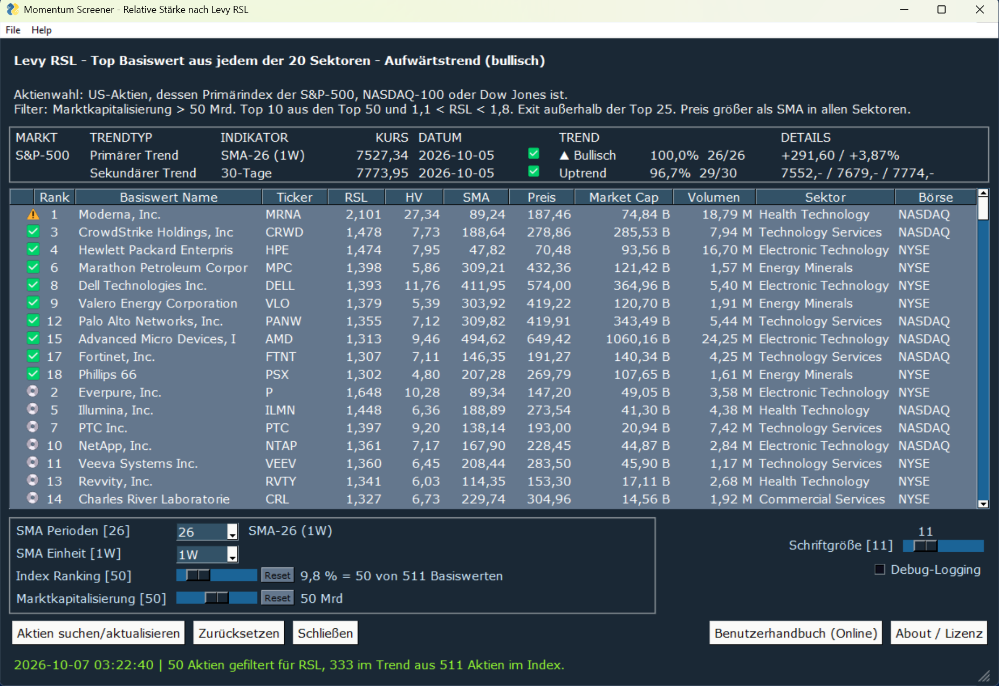

# RSL Momentum Screener – Benutzerhandbuch

**Relative Stärke nach Levy (RSL)** · Version 1.1

Dokumentation: <https://github.com/contensys/trading-tools-rsl-docs/tree/1.1.0>

> **Haftungsausschluss:** Dieses Tool dient ausschließlich Bildungs- und Forschungszwecken.
> Es stellt **keine Anlageberatung** dar, und es werden keine Anlageempfehlungen gegeben.
> Die Entwickler sind keine Finanzberater und übernehmen keine Verantwortung für finanzielle
> Entscheidungen oder Verluste, die aus der Nutzung dieses Tools resultieren. Konsultieren Sie
> immer einen professionellen Finanzberater, bevor Sie Anlageentscheidungen treffen.

**Inhalt**  

1. Überblick und Zweck
2. Installation
3. Key Features
4. Bedienung des Screener Tools
5. Ergebnistabellen und Spaltenbeschreibung
6. Filtereinstellungen
7. Berechnung der Top-10 und des Markttrends
8. Strategie richtig anwenden

---

## 1. Überblick und Zweck

Der **RSL Momentum Screener** ist ein Desktop-Programm, mit dem Sie US-Aktien mit besonders
starker **relativer Stärke** im Vergleich zu ihrem gleitenden Durchschnitt (SMA) finden können
und die ein Momentum signalisieren. Grundlage ist die **Relative Stärke nach Levy (RSL)** und **Historische Volatilität**.  

Das Tool durchsucht die Aktien der großen US-Indizes **S&P-500**, **NASDAQ-100** und
**Dow Jones**, berechnet für jede Aktie die Historische Volatilität, das Verhältnis von Kurs
zu gleitendem Durchschnitt und erstellt eine Rangliste. Die stärksten Basiswerte werden mit
einem Ampelsignal markiert.  

Zudem wird der primäre und sekundäre Markttrend des S&P-500 ermittelt.  

**Datenquelle**  

Die Berechnung erfolgt live von den öffentlichen TradingView- und Yahoo-Finance Datenbanken. Es ist kein Konto und
keine Anmeldung erforderlich. Die Daten sind um 15 Minuten verzögert.  

---

## 2. Installation 

Die fertigen Programmpakete stehen im OneDrive-Bereich zum Download bereit:

➡️ **Download:**  
<https://schranz.sharepoint.com/:f:/s/bigbusiness/IgBePagCvFo4TKmHnN8BnKdQAZoA5pxNeliCAKHlAJi7RkM>

| Plattform | Paketname                              |
|-----------|----------------------------------------|
| [](https://schranz.sharepoint.com/:f:/s/bigbusiness/IgBePagCvFo4TKmHnN8BnKdQAZoA5pxNeliCAKHlAJi7RkM) | [`RSL-MomentumScreener-macos-arm.zip`](https://schranz.sharepoint.com/:f:/s/bigbusiness/IgBePagCvFo4TKmHnN8BnKdQAZoA5pxNeliCAKHlAJi7RkM)   |
| [](https://schranz.sharepoint.com/:f:/s/bigbusiness/IgBePagCvFo4TKmHnN8BnKdQAZoA5pxNeliCAKHlAJi7RkM) | [`RSL-MomentumScreener-win-x86-64.zip`](https://schranz.sharepoint.com/:f:/s/bigbusiness/IgBePagCvFo4TKmHnN8BnKdQAZoA5pxNeliCAKHlAJi7RkM)  |

### 2.1 Installation MacOS (Apple Silicon / ARM)

Das macOS-Paket ist **signiert und notariell beglaubigt (notarized)** und kann daher ohne
zusätzliche Sicherheitswarnungen gestartet werden.

1. Datei `RSL-MomentumScreener-macos-arm.zip` herunterladen. Das ZIP-Archiv wird in der Regel
   automatisch entpackt.
2. Die App **`RSL-MomentumScreener.app`** an einen in den Ordner **`/Programme` (/Applications)**.
3. App per Doppelklick starten.

> ⚠️ **Wichtige Einschränkung:** Starten Sie die App **nicht direkt aus dem Ordner „Downloads“**.
> MacOS führt Programme aus dem Download-Ordner in einer eingeschränkten Umgebung aus, wodurch
> die App nicht korrekt funktioniert. Verschieben Sie die App vorher in den Ordner „Programme“.

### 2.2 Installation Windows (64-Bit)

Das Windows-Paket ist **nicht signiert**. Windows Defender (SmartScreen) wird den Start daher
zunächst blockieren. Das ist normal und kein Hinweis auf Schadsoftware.

1. Datei `RSL-MomentumScreener-win-x86-64.zip` herunterladen und entpacken.
2. Die Datei **`RSL-MomentumScreener.exe`** per Doppelklick starten.
3. Erscheint die Meldung **„Der Computer wurde durch Windows geschützt“**:
   - Auf **„Weitere Informationen“** klicken.
   - Anschließend auf **„Trotzdem ausführen“ (Run anyway)** klicken.

Diese Bestätigung ist nur beim ersten Start erforderlich.

---

## 3. Key Features

- **Ampelfarben:** Die Top-10 werden mit Emojis markiert. (✅, ⚠️, 🔴)
- **Exit Signal:** Alle Basiswerte innerhalb des Top-n Rangliste werden markiert. (💿) Positionen außerhalb der Top-n Rangliste werden verkauft.
- **Relative Stärke nach Levy:** Der RSL Indikator wird für alle Basiswerte des Index berechnet.
- **Historische Volatilität:** Berechnung der Historischen Volatilität nach Levy zur Ermittlung des Momentum.
- **Rangliste:** Es wird eine Rangliste 1..n über alle Basiswerte des Index erstellt.
- **Markttrend Bewertung:** Es wird der primäre Trend der letzten 26 Wochen und sekundäre Trend der letzten 30 Tage berechnet. Das Ergebnise wird mithilfe von Ampelfarben und Trendrichtung angezeigt (Bullisch, Bärisch, Uptrend, Downtrend und Mixed).
- **Selektive Auswahl Basiswerte:** Es werden die alle relevanten Basiswerte des Index ermittelt und aufgelistet. Die Liste enthält alle Basiswerte, die über dem Median der Historischen Volatilität liegen oder einen RSL > 1,0 haben.
- **Sortieren:** Alle Spalten der Tabelle können per Mausklick aufsteigend und absteigend sortiert werden.
- **Suchen und Filter:** Basiswerte können durch einfache Eingabe des Tickers gesucht und gefiltert werden.
- **Filtereinstellungen:** Die Marktkapitalisierung, die Anzahl der Rangliste, der Zeitraum (Perioden) und die Zeiteinheit (Tage, Wochen, Monate) kann bei Bedarf geändert werden. Mit einem Knopfdruck können die empfohlenen Standardeinstellungen wiederhergestellt werden.
- **Schnelles Laden:** Die Daten werden für 15 Minuten gespeichert. Danach werden diese neue geladen und neu berechnet. So können unterschiedliche Perioden und Einheiten geladen werden und schnell wieder zurück wechseln. Zudem werden die maximalen Abfragelimits geschont.
- **Fehlerbehandlung:** Schwerwiegende Fehler werden in Deutsch angezeigt. Darunter sind auch "Abfrage Einschränkungen", "Verbindungsfehler", "Berechnungsfehler" u.v.m.
- **Schriftgröße:** Die Schriftgröße der Basiswert Tabelle und Markttrendbewertung kann geändert werden. Die Größe der App wird automatisch angepasst.

---

## 4. Bedienung des Screener Tools

Nach dem Start erscheint zunächst ein **Lizenz-/Hinweisfenster (About / Lizenz)**. Mit **„OK“**
bestätigen Sie die Nutzungsbedingungen und gelangen in die Anwendung. Mit **„Cancel“** wird die
Anwendung beendet.  



### 4.1 Daten laden

1. Der Screener startet mit den für die RSL Strategie passenden Filtereinstellungen.
   Diese können nach Wunsch und Bedarf angepasst werden (siehe Abschnitt 6).
2. Auf **„Aktien suchen/aktualisieren“** klicken.
3. Der Text des Buttons ändert sich in *⏰ Aktualisiere Daten* während die Daten geladen werden und
   es wird der Ladestatus für jeden Datenbereich angezeigt. Die Information wird am Ende automatisch
   ausgeblendet.  
4. Die Ergebnisse werden in den der Tabellen aufgelistet.
5. In der Statuszeile wird das Datum der letzten Aktualisierung angezeigt, die Anzahl gefilterten Basiswerte
   und wieviele Basiswerte in der Tabelle angezeigt werden.  
   z.B. *„2026-10-07 04:20:30 | 50 Aktien gefilter für RSL, 350 im Trend aus 507 Aktien im Index.“*.  

> ℹ️ **Wichtig:** Nach **jeder** Änderung an den Filtereinstellungen müssen Sie erneut auf
> **„Aktien suchen/aktualisieren“** klicken, damit die Tabellen aktualisiert werden.

### 4.2 Schaltflächen

| Schaltfläche                  | Funktion                                                                |
|:------------------------------|:------------------------------------------------------------------------|
| **Aktien suchen/aktualisieren** | Lädt bzw. aktualisiert die Ergebnisse anhand der Filtereinstellungen. |
| **Zurücksetzen**              | Setzt alle Filter auf die Standardwerte zurück und leert die Tabellen.  |
| **Schließen**                 | Beendet die Anwendung. |
| **Neue Version verfügbar**    | Diese Schaltfläche wird eingeblendet, wenn eine neue Version verfügbar ist. |
| **Benutzerhandbuch (Online)** | Dieses Benutzerhandbuch. |
| **About / Lizenz**            | Zeigt die Lizenz- und Hinweisinformationen an. |

---

## 5. Die Ergebnistabellen – Spaltenbeschreibung

| Spalte             | Bedeutung                                                                                              |
|--------------------|--------------------------------------------------------------------------------------------------------|
| **Rank**           | Platzierung innerhalb des Index-Rankings (1 = höchste relative Stärke, bei Abwärtstrend die schwächste Stärke). |
| **Basiswert Name** | Vollständiger Name des Unternehmens bzw. der Aktie.                                                    |
| **Ticker**         | Börsenkürzel (Symbol) der Aktie.                                                                       |
| **RSL**            | Relative Stärke nach Levy = **Kurs ÷ gleitender Durchschnitt (SMA)**. Siehe Abschnitt 7 und 8.         |
| **HV**             | Historische Volatilität nach Levy = **Standardabweichung der letzten 26 Wochen**. Siehe Abschnitt 7.   |
| **SMA**            | Wert des gewählten gleitenden Durchschnitts (z. B. SMA-26 auf Wochenbasis).                            |
| **Preis**          | Aktueller Kurs (Schlusskurs) der Aktie.                                                                |
| **Market Cap**     | Marktkapitalisierung in Milliarden US-Dollar (B = Billion (Englisch)).                                 |
| **Volumen**        | Handelsvolumen in Millionen (M).                                                                       |
| **Sektor**         | Sektor, dem die Aktie zugeordnet ist.                                                                  |
| **Börse**          | Handelsplatz der Aktie (NASDAQ oder NYSE).                                                             |

---

## 6. Filtereinstellungen

| Filter                  | Standardwert                  | Bedeutung                                                                                                                                                  |
|-------------------------|-------------------------------|----------------------------------------------------------------------------------------------------------------------------------------------------------|
| **SMA Perioden**        | **26**                        | Anzahl der Perioden für den gleitenden Durchschnitt. Auswahl: 10, 20, 26, 34, 50, 100, 200, 250.                                                          |
| **SMA Einheit**         | **1W** (Woche)                | Zeiteinheit je Periode: `1D` = Tag, `1W` = Woche, `1M` = Monat. Beispiel: *SMA Perioden 26* + *Einheit 1W* = **SMA über 26 Wochen**.                       |
| **Index Ranking**       | **50**                        | Es werden nur Basiswerte in der Auswahl berücksichtigt, die niedriger als dieser Wert ist. Die Top-10 müssen in der Rangliste unterhalb der Hälfte dieses Wertes liegen. (Bereich 10–250). |
| **Marktkapitalisierung** | **50**                       | Ein Basiswert wird für die Top-10 selektiert, wenn die Marktkapitalisierung über diesem Wert liegt. (Bereich 1–100). |
| **Schriftgröße**        | **11**                        | Schriftgröße der Ergebnistabelle und Markttrend Bericht. (Schritfgrößen 9–20)                                                                              |
| **Debug-Logging**       | **aus**                       | Schreibt detaillierte Diagnoseinformationen in die Protokolldatei `screener-levy-rsl.log`. Nur für die Fehleranalyse erforderlich.                        |

**Feste Auswahlkriterien** (nicht veränderbar): US-Aktien, deren Primärindex der S&P-500,
NASDAQ-100 oder Dow Jones ist, gehandelt an NASDAQ oder NYSE, mit einer Marktkapitalisierung
von **über 50 Mrd. USD**.

> Mit **„Zurücksetzen“** stellen Sie alle Filter wieder auf die oben genannten Standardwerte ein.

---

### 7 Berechnung der Top-10 und des Markttrends

**Auswahl der Basiswerte (Filter Kriterien)**  

Die Basiswerte werden nach folgenden Kriterien berechnet, gefiltert und angezeigt.  

- Nur Basiswerte mit einer **Historische Volatilität** oberhalb des Median kommen in die Auswahl.
- Der letzte **Schlußkurs** muss höher als der gewählte SMA sein (RSA > 1,0).
- In die Top 10 werden nur Basiswerte gewählt, die höher als die gewählte **Marktkapitalisierung** liegen (Standard: 50 Mrd US$)
- Der Basiswert muss in den oben genannten **Indexes primär gelistet** sein
- Der RSL-Wert des Basiswertes muss in der Rangliste der **Top 50 des Indexes** liegen (oder dessen konfigurierter Wert). Mehr Details hierzu finden sie im Kapitel "Strategie richtig anwenden".
- In den Top-10 werden nur Werte mit einem RSA > 1,0 und < 1,8 gewählt. Basiswerte mit RSA > 1,8 werden als Sicherheits-Leitplanken gegen Überhitzung (Blasen) und vor Trendumkehr bewusst rausgefiltert.

---

## 8. Strategie richtig anwenden

Die Standardeinstellungen (SMA-26 auf Wochenbasis, Aufwärtstrend, Top-10 aller Sektoren,
Index Ranking 50) bilden die **Hauptstrategie** ab und sind für die meisten Anwender die
richtige Wahl.

### Den Markttrend prüfen

Die **RSL Momentum** Stratgie erfordert immer mit dem Trend zu handeln. Hierzu ermitteln wir zusätzich zur Stärke jeder einzelenen Positionen insbesondere auch den Trend des gesamten Marktes. Dies erhöht die Wahrscheinlichkeit erfolreich zu sein.

#### Zwei Marktrends

Wir unterscheiden zwischen dem primären und sekundären Trend.

| Trend | Zeitraum | Beschreibung |
| :--- | :--- | :--- |
| **Primär** | 26 Wochen | Der 26-Wochen-Trend des S&P 500 bestimmt die **grundlegende Fahrtrichtung des Portfolios** (Investiert vs. Cash).<br/>**Die Bedingung**: Der letzte ermittelte Kurs des S&P 500 muss über seinem gleitenden 26-Wochen-Durchschnitt notieren.<br/>**Die Funktion**: Dieser Filter schützt Sie vor Systemkrisen. Befindet sich der S&P 500 unter dieser Linie, befindet sich der Gesamtmarkt im Bärenmarkt.<br/>**Die Konsequenz**: Kaufsignale für Einzelaktien werden **vollständig blockiert**, bestehende Positionen werden je nach Regelwerk schrittweise abgebaut oder eingefroren. Das Portfolio wechselt in Cash oder andere Asset Klasse. |
| **Sekundär** | 30 Tage | Der sekundäre Trend dient als **Timing-Instrument** und verhindert, dass Sie mitten in eine kurzfristige Marktkorrektur hineinkaufen.<br/>**Die Bedingung**: Der Durchschnittskurs des S&P 500 der letzten 30 Tage muss höher sein als der Durchschnittskurs der vorangegangenen 30 Tage (bzw. der aktuelle Kurs liegt über dem 30-Tage-Schnitt).<br/>**Die Funktion**: Selbst in einem intakten Bullenmarkt (primärer Trend positiv) gibt es immer wieder wochenlange Korrekturen. Würden Sie hier blind Aktien nachkaufen, greifen Sie oft in ein fallendes Messer.<br/>**Die Konsequenz**: Nur wenn der sekundäre Trend anzeigt, dass sich der S&P 500 kurzfristig wieder **stabilisiert oder nach oben dreht**, wird das grüne Licht für neue Aktienkäufe freigegeben. |

#### Das Ampelsystem des Markttrends

In der Praxis der Momentum-Strategie werden diese beiden Markttrends zu einem hocheffizienten Filter verknüpft:

| Primärtrend | Sekundärtrend | Marktzustand | Strategische Position im Depot |
| :--- | :--- | :--- | :--- |
| ✅ ▲ Bullisch | ✅ **Uptrend**<br/>(>80% oberhalb SMA) | Voller Bullenmarkt | **Grünes Licht**: Volle Investition. Neue Top-10-Aktien werden gekauft. |
| ✅ ▲ Bullisch | ⚠️ Mixed<br/>(>50% oberhalb SMA) | Gesunde Korrektur | **Gelbes Licht**: Bestehende Aktien halten. Keine Neukäufe (Cash aufbauen). |
| 🔴 ▼ Bärisch | 🔴 Downtrend | Bärenmarkt / Crash | **Rotes Licht**: Keine Käufe. Konsequente Absicherung / Liquidität. |

**Warum ist der Markttrend für die Top-10-Auswahl so wichtig?**  

Aktien mit hoher historischer Volatilität (oberhalb des Medians) besitzen ein hohes "Beta". Das bedeutet: Sie steigen im Bullenmarkt viel schneller als der Markt – sie fallen im Bärenmarkt aber auch drastisch schneller.  

Ohne die Prüfung des primären und sekundären Markttrends würde die RSL-Strategie Sie in einer Korrektur genau in die Aktien zwingen, die am stärksten einbrechen. Der Gesamtmarkt-Filter sorgt dafür, dass Sie das Gaspedal nur dann durchdrücken, wenn der Markt echten Rückenwind hat.  

### Die RSL-Kennzahl verstehen

Die **Relative Stärke nach Levy (RSL)** ist das Verhältnis von Kurs zu gleitendem Durchschnitt:

```text
RSL = Kurs ÷ SMA
```

| RSL-Wert         | Bedeutung                                                                                  |
|------------------|--------------------------------------------------------------------------------------------|
| **RSL > 1,0**    | **Aufwärtstrend (bullisch)** – der Kurs liegt über dem Durchschnitt.                        |
| **RSL ≈ 1,0**    | **Seitwärtstrend** – keine klare Richtung. Die RSL-Strategie funktioniert hier nur **mäßig** bis **nicht**.  |
| **RSL < 1,0**    | **Abwärtstrend (bärisch)** – der Kurs liegt unter dem Durchschnitt.                         |

#### Zur Trendstärke

Je näher der RSL-Wert an 1,0 liegt, desto schwächer der Trend und folgedessen wird man im Basiswert länger investiert sein. Ich empfehle in Werte mit einem Trend zwischen 10% und 80% zu investieren (1,10 < RSA < 1,80).

#### Zur Größenordnung

Ein bärischer Wert kann nur zwischen **0 und 1** liegen, ein bullischer Wert ist dagegen **theoretisch unbegrenzt** nach oben möglich. Ein RSL von **0,5** entspricht somit einem Rückgang (Drawdown) von rund **50 %**, während ein RSL von **2,0** einer Aufwärtsbewegung von etwa **100 %** der gewählten Zeitspanne des SMA entspricht.

### Das Ranking verstehen

Die Zahl in der Spalte **"Rank"** gibt den Rang des Basiswertes (Aktie) im Index an. Im Index wird die relative Stärke (RSL) für **alle** Aktien berechnet und nach diesem sortiert. Somit hat die Nr. 1 den stärksten Trend in der jeweiligen Trendfolge.  

### Empfehlungen zur Trendwahl

- **Handeln Sie diese Strategie niemals gegen den Trend. Verwenden Sie die bärische Strategie nicht, solange der Index im Bullenmarkt befindet.**
- Liegt die RSL bei oder nahe **1,0** (Seitwärtstrend), liefert die Strategie keine verwertbaren
  Signale (siehe Kapitel "Trendstärke" oberhalb).

### Umsetzung der Strategie

Bitte folgen Sie der Anleitung, wie wir diese im Seminar gelernt haben. Danke.  

#### Die Kaufregel (Einstieg)

- **Aktion**: Es werden strikt die Plätze mit ✅ gekennzeichneten gekauft. Basiswerte werden mit ⚠️ gekennzeichnet, wenn der RSA > 1,8 liegt oder der sekundäre Markttrend mit "Mixed" bewertet ist. Diese Basiswerte können sie optional je nach Risikobereitschaft gekauft werden. Das Kapital wird exakt zu gleichen Teilen (je 10 %) aufgeteilt.

#### Die Trägheitsregel / Verkaufsregel (Ausstieg)

- **Problem**: Fällt die Aktie von Platz 10 auf Platz 11, würde ein sofortiger Verkauf enorme Transaktionskosten verursachen.
- **Lösung** nach Levy: Eine Aktie wird **nicht** sofort verkauft, wenn sie aus den Top 10 rutscht. Sie wird so lange im Depot gehalten, wie sie sich in der erweiterten Spitzengruppe - mit 💿 gekennzeichnet - der qualifizierten Liste aufhält.
- **Verkaufssignal**: Erst wenn die Aktie nicht mehr mit 💿 gekennzeichnet ist (keine Markierung hat), wird sie verkauft. Der frei gewordene Platz wird durch den nächstbesten Aufsteiger aus den Top 10 besetzt, den man noch nicht besitzt.

---

*© 2026 Juergen Schranz – The DevOps Engineers · Lizenz: Apache License 2.0*
